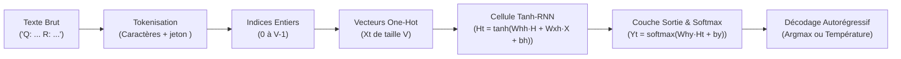
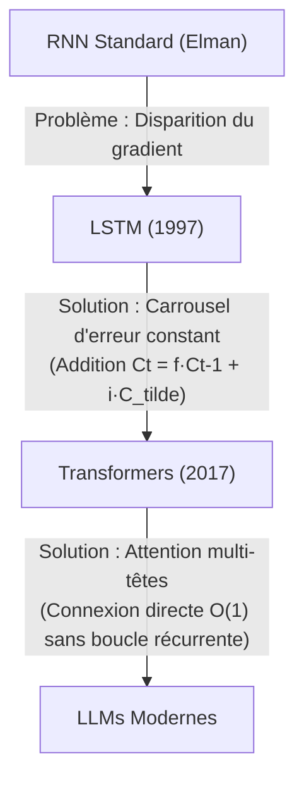

# TP TALN : Réseau de Neurones Récurrent (Tanh-RNN) from Scratch en Python Pur

> **Master M2I — Cours de Traitement Automatique du Langage Naturel (Pr. A. Mazroui)**  
> **Contraintes strictes :** 100% Python 3 pur, aucune bibliothèque externe (`numpy`, `torch`, `tensorflow`, `sklearn`, `pandas` strictement interdits).  
> **Modules autorisés :** uniquement `math` (`exp`, `log`) et `random` (`seed`, `uniform`, `random`). Chronométrage d'époque via `time`.

---

## 1. Objectif du TP et Pipeline Global

L'objectif de ce travail pratique est de construire, d'entraîner et d'analyser **de zéro (from scratch)** un réseau de neurones récurrent (*Elman RNN* à activation $\tanh$) capable de modéliser le langage au niveau des caractères et de générer des réponses à des questions.

### Pipeline de Traitement


1. **Texte brut** : Paires de questions/réponses au format normalisé en minuscules :
   ```text
   Q: comment tu t'appelles ?
   R: je suis un petit rnn.<fin>
   ```
2. **Tokenisation & Vocabulaire** : Découpage caractère par caractère, en préservant `<fin>` comme un jeton atomique unique. Le vocabulaire compte $V = 35$ symboles.
3. **Encodage One-Hot** : Chaque caractère devient un vecteur $X_t \in \{0, 1\}^V$ avec un unique $1.0$ à l'indice du caractère.
4. **Transition Récurrente** : Calcul de l'état caché $H_t$ qui accumule la mémoire de la séquence.
5. **Couche de Sortie & Softmax** : Projection vers l'espace du vocabulaire produisant la distribution prédictive $Y_t$.
6. **Décodage Autorégressif** : Le caractère prédit est réinjecté comme entrée au pas $t+1$ jusqu'au jeton `<fin>`.

---

## 2. Équations du Cours et Correspondance Fichier / Fonction

Tous les noms de variables respectent rigoureusement les notations du cours : `Wxh`, `Whh`, `Why`, `bh`, `by`, `Xt`, `Ht`, `Et`, `Yt`.

| Étape | Équation mathématique | Fichier source | Fonction Python |
| :--- | :--- | :--- | :--- |
| **Activation cachée** | $H_t = \tanh(W_{hh} H_{t-1} + W_{xh} X_t + b_h)$ | [`src/rnn.py`](file:///c:/Users/DELL/Documents/Master/Master_M2I/SEMESTRE%203/NLP/TPs/TP0/src/rnn.py) | `propagation_avant_pas` |
| **Sortie prédictive** | $Y_t = \text{softmax}(W_{hy} H_t + b_y)$ | [`src/rnn.py`](file:///c:/Users/DELL/Documents/Master/Master_M2I/SEMESTRE%203/NLP/TPs/TP0/src/rnn.py) | `propagation_avant_pas` |
| **Softmax stable** | $Y_t[k] = \frac{\exp(z_k - \max(z))}{\sum_j \exp(z_j - \max(z))}$ | [`src/maths_utils.py`](file:///c:/Users/DELL/Documents/Master/Master_M2I/SEMESTRE%203/NLP/TPs/TP0/src/maths_utils.py) | `softmax` |
| **Entropie croisée** | $\text{Err}(Y_t, E_t) = -\sum_{k} E_t[k] \log(Y_t[k] + 10^{-12})$ | [`src/perte.py`](file:///c:/Users/DELL/Documents/Master/Master_M2I/SEMESTRE%203/NLP/TPs/TP0/src/perte.py) | `entropie_croisee` |
| **Erreur séquence** | $\text{Err}(X) = \sum_{t=0}^{T-1} \text{Err}(Y_t, E_t)$ | [`src/perte.py`](file:///c:/Users/DELL/Documents/Master/Master_M2I/SEMESTRE%203/NLP/TPs/TP0/src/perte.py) | `erreur_sequence` |
| **Perplexité** | $\text{PPL} = \exp(\text{Err}_{\text{moyenne}})$ | [`src/perte.py`](file:///c:/Users/DELL/Documents/Master/Master_M2I/SEMESTRE%203/NLP/TPs/TP0/src/perte.py) | `calculer_perplexite` |
| **Gradient sortie** | $d z_{y, t} = Y_t - E_t$ | [`src/bptt.py`](file:///c:/Users/DELL/Documents/Master/Master_M2I/SEMESTRE%203/NLP/TPs/TP0/src/bptt.py) | `retropropager_un_pas` |
| **Gradient caché** | $d H_t = W_{hy}^T d z_{y, t} + d H_{\text{suivant}}$ | [`src/bptt.py`](file:///c:/Users/DELL/Documents/Master/Master_M2I/SEMESTRE%203/NLP/TPs/TP0/src/bptt.py) | `retropropager_un_pas` |
| **Dérivée tanh** | $d z_{h, t} = d H_t \odot (1 - H_t^2)$ | [`src/bptt.py`](file:///c:/Users/DELL/Documents/Master/Master_M2I/SEMESTRE%203/NLP/TPs/TP0/src/bptt.py) | `retropropager_un_pas` |
| **Accumulation BPTT** | $d W_{hh} += d z_{h, t} \cdot H_{t-1}^T$, $d W_{xh} += d z_{h, t} \cdot X_t^T$ | [`src/bptt.py`](file:///c:/Users/DELL/Documents/Master/Master_M2I/SEMESTRE%203/NLP/TPs/TP0/src/bptt.py) | `retropropagation_bptt` |
| **Écrêtage L2** | $g \leftarrow (\text{seuil} / \|g\|) \cdot g \quad \text{si } \|g\| > \text{seuil}$ | [`src/optimiseur.py`](file:///c:/Users/DELL/Documents/Master/Master_M2I/SEMESTRE%203/NLP/TPs/TP0/src/optimiseur.py) | `ecreter_gradients` |
| **Mise à jour SGD** | $P(k+1) = P(k) - \delta \cdot \nabla \text{Err}(P(k))$ | [`src/optimiseur.py`](file:///c:/Users/DELL/Documents/Master/Master_M2I/SEMESTRE%203/NLP/TPs/TP0/src/optimiseur.py) | `mettre_a_jour_parametres` |

---

## 3. Configuration et Guide d'Exécution

Tous les hyperparamètres sont modifiables dans un fichier unique : [`src/config.py`](file:///c:/Users/DELL/Documents/Master/Master_M2I/SEMESTRE%203/NLP/TPs/TP0/src/config.py).

```python
GRAINE = 42             # Graine pour reproductibilite stricte
TAILLE_H = 32           # Dimension de l'etat cache Ht
ECHELLE_POIDS = 0.1     # Initialisation uniforme [-0.1, 0.1]
DELTA = 0.1             # Pas d'apprentissage
SEUIL_ECRETAGE = 5.0    # Seuil de clipping L2 global
EPOQUES_MOT = 200       # Epoques surapprentissage mot unique
EPOQUES_CORPUS = 60     # Epoques entrainement corpus
TEMPERATURE = 0.8       # Temperature de generation
MAX_LONGUEUR = 100      # Longueur maximale reponse
```

### Commandes d'exécution

```bash
# 1. Tests unitaires mathematiques (tanh, derivee, softmax stable, algebre)
python tests/test_maths.py

# 2. Gradient Checking sur mini-modele (V=4, H=3, T=4)
python tests/test_gradient.py

# 3. Demonstration complete (entrainement, courbe ASCII, evaluation 10 questions)
python main.py --demo

# 4. Chatbot interactif en console
python main.py
```

---

## 4. Résultats Expérimentaux et Évaluation

### 4.1. Baisse de la Perte et Perplexité sur le Corpus
L'entraînement sur le corpus de 20 paires Q/R montre une convergence rapide et stable (sauvegardée dans [`resultats/perte.csv`](file:///c:/Users/DELL/Documents/Master/Master_M2I/SEMESTRE%203/NLP/TPs/TP0/resultats/perte.csv)) :

```text
Epoque   1/60 | Perte : 3.1696 | Perplexite :  23.80 | Temps : 593.8 ms
Epoque  10/60 | Perte : 1.8484 | Perplexite :   6.35 | Temps : 635.9 ms
Epoque  20/60 | Perte : 1.5125 | Perplexite :   4.54 | Temps : 594.3 ms
Epoque  30/60 | Perte : 1.2769 | Perplexite :   3.59 | Temps : 620.6 ms
Epoque  40/60 | Perte : 1.1367 | Perplexite :   3.12 | Temps : 663.5 ms
Epoque  50/60 | Perte : 1.0571 | Perplexite :   2.88 | Temps : 595.0 ms
Epoque  60/60 | Perte : 0.9966 | Perplexite :   2.71 | Temps : 618.3 ms
```

### 4.2. Courbe de Perte dans le Terminal (ASCII)
```text
 3.17 | *                                                           
 2.95 |                                                             
 2.73 |  *                                                          
 2.51 |   *                                                         
 2.29 |    *                                                        
 2.07 |     ***                                                     
 1.85 |        *****                                                
 1.63 |             *******                                         
 1.41 |                    **********                               
 1.19 |                              ***************                
 0.97 |                                             ****************
      +------------------------------------------------------------
       Epoque 1                                               Epoque 60
```

### 4.3. Comparaison Argmax vs Température 0.8 (Extrait de `resultats/exemples.txt`)
Le fichier [`resultats/exemples.txt`](file:///c:/Users/DELL/Documents/Master/Master_M2I/SEMESTRE%203/NLP/TPs/TP0/resultats/exemples.txt) contient 10 tests comparatifs systématiques :

1. **Question dans le corpus : `bonjour`**
   - **Argmax ($T=0$) :** `'salut !'` *(parfait, net et déterministe)*
   - **Tirage ($T=0.8$) :** `'a mure.'` *(plus diversifié mais sensible aux perturbations)*
2. **Question dans le corpus : `au revoir`**
   - **Argmax ($T=0$) :** `'a bientot !'` *(exactement la cible attendue)*
   - **Tirage ($T=0.8$) :** `'a bientot !'`
3. **Question hors corpus : `quel temps fait-il ?` (Limite du modèle)**
   - **Argmax :** `'je suis ent va macht ens-tu ?'` *(hallucination par fragments connus)*
   - **Analyse :** Le réseau n'a vu aucune météo pendant l'entraînement. Il projette les caractères d'entrée sur les motifs de n-grammes les plus proches dans son état caché.

> **Remarque méthodologique capitale :** Le fait que le réseau ne réponde pas correctement aux questions hors corpus **n'est pas un bug**, mais l'illustration directe de la capacité de généralisation d'un modèle de langue compact entraîné sur un petit échantillon fermé.

---

## 5. Analyse Théorique Approfondie

### 5.1. Comparaison avec l'Approche Sac de Mots (Chapitre 8)
Le Chapitre 8 étudie les modèles basés sur les fréquences d'occurrences globales (*Bag of Words* / BoW, TF-IDF).

- **Perte de l'ordre temporel :** Le sac de mots est invariant par permutation. Les phrases *« le chat mange la souris »* et *« la souris mange le chat »* ont exactement le même vecteur BoW. Le RNN, en revanche, calcule une trajectoire $H_0 \to H_1 \to H_2 \dots$ où chaque pas dépend de la séquence exacte précédente.
- **Gestion des négations :** Dans un BoW, *« bon, pas mauvais »* et *« mauvais, pas bon »* sont indistinguables. Dans un RNN, l'état $H_t$ bascule dès la lecture du mot *« pas »*.
- **Génération impossible en BoW :** Un sac de mots ne peut pas prédire le caractère suivant de manière autorégressive car il ne possède aucun mécanisme de transition temporelle.

### 5.2. Limite du Tanh-RNN et Disparition du Gradient (*Vanishing Gradient*)
Lors de la rétropropagation BPTT, le gradient propagé de l'instant $T$ vers un pas éloigné $t \ll T$ fait intervenir le produit matriciel des Jacobiennes :

$$\frac{\partial H_T}{\partial H_t} = \prod_{j=t+1}^T \frac{\partial H_j}{\partial H_{j-1}} = \prod_{j=t+1}^T \text{diag}\left(1 - H_j^2\right) \cdot W_{hh}^T$$

Deux facteurs provoquent l'écroulement exponentiel du gradient vers zéro :
1. **Saturation de $\tanh$ :** La dérivée $\tanh'(z) = 1 - H^2$ est strictement inférieure ou égale à $1.0$, et tend vers $0$ dès que $|z| > 2$.
2. **Rayon spectral de $W_{hh}$ :** Si la plus grande valeur propre de $W_{hh}$ a un module inférieur à $1$, la multiplication répétée $(T-t)$ fois amortit le gradient de manière géométrique :
   $$\lim_{T - t \to \infty} \left\| \frac{\partial H_T}{\partial H_t} \right\| = 0$$

### 5.3. Ce que font mieux le LSTM et les Transformers



1. **LSTM (*Long Short-Term Memory*) :**
   - Introduit une cellule mémoire $C_t$ gouvernée par des portes multiplicatives (oubli $f_t$, entrée $i_t$, sortie $o_t$).
   - La mise à jour de la mémoire est **additive** : $C_t = f_t \odot C_{t-1} + i_t \odot \tilde{C}_t$.
   - La dérivée $\frac{\partial C_t}{\partial C_{t-1}} \approx f_t$ ne s'éteint pas exponentiellement quand $f_t \approx 1$, permettant de propager l'erreur sur des centaines de pas.
2. **Transformers (Mécanisme d'Attention) :**
   - Éliminent totalement la récurrence séquentielle au profit de calculs d'attention directe :
     $$\text{Attention}(Q, K, V) = \text{softmax}\left(\frac{Q K^T}{\sqrt{d_k}}\right) V$$
   - Le chemin entre deux jetons distants est de longueur $O(1)$ (direct), éradiquant totalement le goulot d'étranglement temporel du RNN.

---

## 6. Limites Actuelles et Pistes d'Amélioration

1. **Niveau Mots vs Niveau Caractères :** Le modèle actuel travaille au caractère (vocabulaire de 35 symboles). Passer au niveau mots nécessiterait une étape de lemmatisation, un vocabulaire plus large ($V \approx 5000$) et une couche de plongement (*Word Embeddings*).
2. **Architecture Encodeur-Décodeur (Seq2Seq) :** Séparer un RNN encodeur (qui lit la question complète) et un RNN décodeur (qui génère la réponse à partir du vecteur de contexte) offrirait une séparation plus nette que le simple amorçage textuel.
3. **Volume de données :** Le corpus actuel (20 paires) est taillé pour la rapidité pédagogique en Python pur. Un corpus plus large permettrait de généraliser à des variations syntaxiques plus riches.
